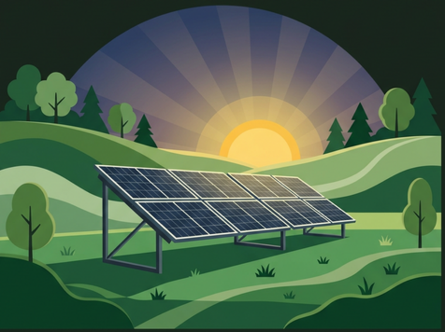

<p align="center">
  
</p>

<h1 align="center">Eco Farm Tech</h1>

<p align="center">
  <strong>Solar-powered electricity for sustainable farming</strong><br />
  A monitoring dashboard prototype that connects solar generation, irrigation and farm energy use.
</p>

<p align="center">
  <a href="https://ecofarm-tech.vercel.app/#dashboard"></a>
  
  
  
  
</p>

<p align="center">
  
  
  
  
</p>

> [!IMPORTANT]
> **This is a student venture concept and digital prototype (Version 1.0).**
> It is **not** connected to an installed solar system. Every figure — generation,
> consumption, tariffs, invoices, savings and emissions — is illustrative demo data,
> not a live reading, quotation, tariff or approval.

---

## Table of contents

- [Overview](#overview)
- [Feature highlights](#feature-highlights)
- [Tech stack](#tech-stack)
- [Quick start](#quick-start)
- [Docker](#docker)
- [Project structure](#project-structure)
- [Demo data & consistency notes](#demo-data--consistency-notes)
- [Business model](#business-model)
- [Accessibility & performance](#accessibility--performance)
- [Deployment](#deployment)
- [Roadmap](#roadmap)
- [Contributing](#contributing)
- [License](#license)

---

## Overview

Farm operations depend on a reliable electricity supply for water pumping and
irrigation. Power interruptions and energy expenses can affect productivity, and
many farms have no clear view of how much energy each activity consumes.

Eco Farm Tech proposes a solar system that:

- generates electricity from sunlight using photovoltaic (PV) panels,
- converts DC output into usable AC electricity through an inverter,
- supplies power to irrigation pumps and selected farm equipment,
- optionally stores surplus electricity in a battery,
- exposes generation, consumption and system status through this dashboard.

**The problem:** unreliable / costly farm electricity and no visibility into usage.
**The proposal:** solar generation plus a dashboard that makes energy use understandable.
**This repository:** the dashboard prototype — a single-page, dependency-free web app.

Live demo: <https://ecofarm-tech.vercel.app/#dashboard> · snapshot documented for **04 Nov 2026, 12:30 PM**.

---

## Feature highlights

Eleven hash-routed pages, grouped in the sidebar the same way the site presents them.

| Group | Page | What it shows |
|-------|------|---------------|
| Overview | **Dashboard** | Headline metrics (8.5 kW output, 42.3 kWh today, pump ON, farm health), generation curve with peak marker, live farm view, quick info, today's energy flow, usage donut, recent activity, alerts |
| Overview | **Owner Profile** | Privacy-safe, clearly-labelled demo profile: account, subscription, farm profile, system specification, sample documents, support and activity |
| Monitoring | **Solar Power** | Generation summary, daily breakdown, panel-string health, inverter, battery bank, solar conditions and a net-metering caveat |
| Monitoring | **Farm Monitoring** | Soil moisture, temperature, humidity, crop condition meters, field zones and connected sensor list |
| Monitoring | **Irrigation Control** | Working pump switch, water delivered, schedule, zone status, pump health and water source |
| Business | **Savings & Impact** | Interactive savings calculator (capacity, panels, daily use, price) with an environmental impact panel |
| Business | **Pricing & Revenue** | Basic / Standard / Premium packages, pay-per-use billing explained, operating model with a 1-farm / 3-farm switch, revenue vs expenses, break-even projection |
| Business | **Farmer Registration** | Enquiry form with validation and success state, plus a four-step onboarding explainer |
| Business | **About** | Problem, solution, system flow, audience, benefits, risks, contact and future scope |
| Insights | **Reports** | Month-to-date and monthly summaries, CSV export, print stylesheet, available report documents |
| Insights | **Settings** | Account form, notification switches, alert thresholds, system configuration, security notes |

Plus:

- 🌙 **Dark mode** — top-right toggle, saved to `localStorage`, charts and all surfaces themed.
- 📊 **Charts without libraries** — generation curves, donut and bar charts are hand-built SVG.
- 📱 **Responsive** — off-canvas navigation and single-column layouts down to ~360 px.
- ♿ **Accessible** — labelled controls, `aria-pressed`/`role="switch"`, visible focus rings, reduced-motion support.
- 🖨️ **Print stylesheet** — the Reports page prints cleanly.
- ⚡ **Zero runtime dependencies** — no framework, no bundler, no build step.
- 🎞️ **Motion** — page fades with staggered card entrances, animated chart swaps,
  growing bars and donut reveals, count-up calculator figures, and a View Transitions
  crossfade when the theme changes. Everything respects `prefers-reduced-motion`.
- 🧭 **Overlap-proof header** — the centred title and the header actions are laid out
  with CSS container queries against the bar's real width, so the clock can never slide
  underneath the title, whatever the sidebar does.

---

## Tech stack

| Layer | Choice | Why |
|-------|--------|-----|
| Markup | Semantic HTML5 | Readable, crawlable, no hydration cost |
| Styling | CSS custom properties + grid/flex | Theming via tokens; one file, no preprocessor |
| Behaviour | Vanilla JavaScript (ES2019+) | Charts, routing, calculator and forms without a dependency tree |
| Charts | Hand-written SVG | Full control, theme-aware, tiny footprint |
| Fonts | Inter (body) + Sora (display) via Google Fonts | Clean pairing; remove the `<link>` to self-host |
| Serving | nginx (Alpine) in Docker, or any static host | Identical locally and in production |
| Tooling | Node scripts + GitHub Actions | Dependency-free checks and container smoke test |

---

## Quick start

The site is static — any file server works.

```bash
git clone https://github.com/SHAILENDRA-REDDY/EcoFarm-Tech.git
cd EcoFarm-Tech

# option 1 — Makefile
make serve                      # → http://localhost:4173

# option 2 — Python
python3 -m http.server 4173

# option 3 — anything else
npx serve .
```

Open <http://localhost:4173> and use the sidebar. Routes are hash-based, e.g.
`/#dashboard`, `/#calculator`, `/#business`, `/#register`.

### Checks

```bash
make lint     # JavaScript syntax + HTML structure (ids, icons, routes, assets)
make check    # required files + the above, exactly what CI runs
```

---

## Docker

A hardened nginx image runs as a non-root user on port **8080**.

```bash
# build and run with Compose
docker compose up --build        # → http://localhost:8080

# or plain Docker
make docker-build
make docker-run
```

Details:

- multi-stage `nginx:1.27-alpine` runtime, read-only root filesystem,
  `cap_drop: [ALL]`, `no-new-privileges`,
- gzip for text assets, long-lived caching for CSS/JS/images, no-cache HTML shell,
- security headers: `X-Content-Type-Options`, `X-Frame-Options`, `Referrer-Policy`,
  `Permissions-Policy`, `Cross-Origin-Opener-Policy`,
- `/healthz` endpoint used by the container `HEALTHCHECK`.

| File | Purpose |
|------|---------|
| `Dockerfile` | Image build, non-root user, healthcheck |
| `nginx-main.conf` | Minimal `http {}` block with logging and compression |
| `nginx.conf` | Server block, caching rules, security headers, SPA fallback |
| `docker-compose.yml` | One-command local run with healthcheck and labels |
| `.dockerignore` | Keeps build context small and clean |

---

## Project structure

```text
EcoFarm-Tech/
├── index.html                 # app shell: sidebar, top bar, 11 page sections
├── css/
│   └── styles.css             # tokens, layout, components, dark theme, print
├── js/
│   ├── data.js                # demo dataset + business/calculator data (window.EFT_*)
│   └── app.js                 # routing, charts, dark mode, calculator, forms
├── assets/
│   ├── farm-live.jpg          # "live farm view" photography
│   └── scene-crop.png         # sidebar/banner illustration
├── scripts/
│   ├── check-html.mjs         # ids, icon references, routes, asset paths
│   └── check-files.mjs        # required files + HTML checks (used by CI)
├── .github/
│   ├── workflows/ci.yml       # verify + docker build + container smoke test
│   ├── ISSUE_TEMPLATE/        # bug report / feature request forms
│   └── pull_request_template.md
├── Dockerfile
├── docker-compose.yml
├── nginx.conf · nginx-main.conf
├── Makefile
├── LICENSE                    # MIT
├── CHANGELOG.md
├── CONTRIBUTING.md
├── CODE_OF_CONDUCT.md
├── SECURITY.md
├── .gitignore · .gitattributes · .dockerignore · .editorconfig
└── README.md
```

---

## Demo data & consistency notes

The header carries a **live ticking clock** next to a LIVE badge, so the interface
feels current — but the underlying dataset is a fixed, illustrative sample rather
than telemetry from hardware. To keep the story consistent, the chart's peak note
adapts to the time of day: before 12:15 PM it reads *"Expected peak 8.5 kW around
12:15 PM"*, afterwards *"Peak 8.5 kW at 12:15 PM"*.

Review feedback has been applied:

| Issue raised | Resolution in this version |
|---|---|
| 18 × 550 Wp was labelled 10 kWp | Capacity corrected to **9.9 kWp** in the dashboard, owner profile and settings |
| November showed 22 generation days on 4 Nov | Reporting now shows **month-to-date figures for 4 generation days** (168.4 kWh generated, 109.2 kWh consumed, 59.2 kWh stored/exported) |
| Peak 8.5 kW "at 12:15 PM" clashed with the header clock | Clock is now **live** and the peak note switches between "expected" and recorded depending on the current time |
| Pay-per-use pricing was unexplained | **Pricing & Revenue** page explains metered kWh × agreed rate, monthly settlement and export caveats |
| Grid export / net metering unqualified | Caveat card on **Solar Power** and in billing copy: export and credits depend on DISCOM approvals and regulations |
| Owner profile exposed personal data | Phone, email, street address, coordinates, consumer number and emergency contact removed; the profile is masked and labelled fictional |

Key demo values used throughout: **8.5 kW** current output · **42.3 kWh** generated today ·
**18.6 kWh** pump · **5.8 kWh** other loads · **6.0 kWh** to storage · **82 %** battery ·
**68 %** of usage is the irrigation pump.

---

## Business model

**Primary model — pay-per-use electricity.** Metered solar electricity is billed at
an agreed rate (₹4.20/kWh in this demo) and settled monthly. Any sale of electricity
to third parties requires specific approvals and must comply with local
electricity-supply rules.

**Subscription packages** (proposed, demonstration prices):

| Package | Price | Highlights |
|---|---|---|
| Basic | ₹99 / month | Live monitoring, daily summary, mobile dashboard, email support |
| Standard | ₹199 / month | Alerts, irrigation scheduling, monthly PDF statement, priority support |
| Premium | ₹399 / month | Advanced reports, preventive maintenance, dedicated field engineer, phone support |

**Savings calculator assumptions** — 4.2 equivalent full-output sun hours per day,
30 days per month, all generated electricity usable, savings capped at stated
consumption. **Impact factors** — 0.82 kg CO₂/kWh, 21 kg CO₂ per mature tree per
year, ~0.5 kg coal/kWh. All are indicative teaching factors, not a carbon study.

**Sample operating model** (single farm): electricity revenue ₹4,500 + subscriptions
₹1,000 − maintenance ₹1,000 − employee ₹2,000 − other ₹500 = **₹2,000/month**
illustrative surplus; the three-farm scenario scales this to ~₹90,000/year.
Break-even is derived from a sample ₹4,80,000 capital cost and is a projection only.

---

## Accessibility & performance

- Semantic landmarks (`header`, `nav`, `main`, `section`, `footer`) and a single `<h1>`.
- All interactive controls are real `<button>`/`<a>` elements with accessible names.
- Switches expose `role="switch"` and `aria-checked`; the theme toggle exposes `aria-pressed`.
- Focus is always visible; `prefers-reduced-motion` disables animation.
- Colour is never the only signal — status always carries a text label.
- No web fonts blocking first paint beyond a `display=swap` stylesheet; total page weight
  is roughly 0.7 MB, dominated by two images.
- No analytics, no cookies, no third-party scripts.

---

## Deployment

Any static host works out of the box.

| Target | How |
|---|---|
| **Docker** | `docker compose up --build` → port 8080 |
| **Vercel / Netlify** | Import the repo, no build command, output directory `/` |
| **GitHub Pages** | Serve the repository root from the default branch |
| **nginx** | Copy `index.html`, `css/`, `js/`, `assets/` behind the provided `nginx.conf` |

---

## Roadmap

- [x] Monitoring dashboard with charts and alerts
- [x] Dark mode, responsive layout, owner profile
- [x] Savings calculator, pricing packages, operating model
- [x] Environmental impact estimates and farmer enquiry form
- [x] Docker image, CI checks and repository documentation
- [ ] Live inverter / energy-meter integration (Modbus or vendor API)
- [ ] Backend for enquiries with server-side validation and email notifications
- [ ] Irrigation scheduling based on forecast solar output
- [ ] Monthly PDF statements generated client-side with real data
- [ ] Multi-farm tenancy and role-based access

---

## Contributing

Contributions are welcome — see [CONTRIBUTING.md](CONTRIBUTING.md) for the
workflow, coding conventions and the checks to run before opening a pull request.
By taking part you agree to follow the [Code of Conduct](CODE_OF_CONDUCT.md).

Found a security problem? Please follow [SECURITY.md](SECURITY.md) instead of filing
a public issue.

Notable changes are tracked in [CHANGELOG.md](CHANGELOG.md).

---

## License

Released under the [MIT License](LICENSE). © 2026 Eco Farm Tech.

## Disclaimer

This repository describes a **proposed student venture** and an **illustrative digital
dashboard**. It is not a construction design, electrical installation guide, live
monitoring service, financial guarantee, tariff approval or regulatory endorsement.
Actual generation, savings and environmental benefits depend on system design, solar
resource, usage patterns, equipment, financing and maintenance. Electrical work must be
designed, installed and commissioned by qualified solar and electrical professionals in
compliance with applicable local requirements.

<p align="center"><em>Eco Farm Tech · Smarter Farms, Brighter Future · © 2026</em></p>
